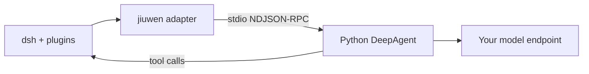
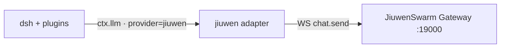

<p align="center"></p>

<h1 align="center">dsh-jiuwen-adapter</h1>

<p align="center"><b>Use Jiuwen as the brain of dsh, with your other dsh plugins still working.</b></p>

<p align="center">
  <a href="https://github.com/ThinkFlowLab/dsh-jiuwen-adapter/actions/workflows/ci.yml"></a>
  <a href="./docs/testing.md"></a>
  
  
  <a href="./LICENSE"></a>
</p>

<p align="center"><a href="./README.zh.md">中文</a> · <a href="./docs/quickstart.md">Quickstart</a> · <a href="./docs/configuration.md">Config</a> · <a href="./docs/dsh-integration.md">dsh integration</a> · <a href="./CHANGELOG.md">Changelog</a></p>

---

A compatibility-first Cordis provider for dsh. It has two backends.

**Agent-core (default).** A local [openjiuwen](https://pypi.org/project/openjiuwen/) DeepAgent sidecar: no Gateway, AgentServer, or JiuwenSwarm installation is required. dsh keeps its UI, sessions, plugins, tool execution and permission checks; agent-core runs the agent loop.



**JiuwenSwarm Gateway.** Each turn goes to the [JiuwenSwarm](https://pypi.org/project/workswarm/) Gateway, which runs its own agents, tools and memory. Use this path for team/workflow execution, marketplace operations, or to keep existing Gateway-owned history.



Set `backend: gateway` to use this path. Details: [Quickstart](./docs/quickstart.md) and [backend migration](./docs/agent-core.md).

## Quickstart

Node ≥22, Python 3.13, and dsh `>=0.2.1-rc.2 <0.3.0`. No Gateway required.

```bash
git clone https://github.com/ThinkFlowLab/dsh-jiuwen-adapter.git
cd dsh-jiuwen-adapter
npm run sidecar:setup                  # pinned openjiuwen 0.1.20.post1
dsh plugin --profile web add "$PWD"
dsh --profile web
```

In the dsh UI open **Settings → Models**, select **JiuwenSwarm**, and fill in the
API key, endpoint, and model list. Then pick a Jiuwen model in the composer
(or set it as the default). You do not need to edit `cordis.patch.yml` or export
`AGENTCORE_MODEL` / `AGENTCORE_API_BASE` to choose a model.

Headless setup, env fallbacks, and the Gateway path (`backend: gateway`) are in
[Quickstart](./docs/quickstart.md).

## What runs where

| Responsibility | Owner |
|---|---|
| ReAct loop, streaming, context compaction, checkpoint history | agent-core sidecar |
| UI, session lifecycle, plugins, bash/file tools and their approvals | dsh |
| Session mappings, configuration and `/jiuwen` commands | adapter |
| Optional skills, planning, memory, subagents, RAG and rails | agent-core; opt-in, dsh-gated |

All **extra `agentcore.*` capabilities default off**. Enable them individually:

```yaml
- id: llm-jiuwen
  config:
    agentcore:
      skills: true
      planning: true                   # mirrors native todos into dsh
      memory: { scope: global }        # persistent keyword search without embeddings
```

See [all capability options and limits](./docs/agentcore-capabilities.md). Host tools
always execute through dsh; additional native IO/MCP tools require dsh approval and
deny on missing answers. Native skills, todos and subagents hide their corresponding
host tools to avoid duplicate tool families. Workspaces and memory stay in the
adapter data directory, not your project root.

Useful commands in an interactive dsh surface:

- `/jiuwen status`, `/jiuwen capabilities`, `/jiuwen help`
- `/jiuwen memory list`, `/jiuwen memory search <query>`
- `/jiuwen compact`, `/jiuwen history`, `/jiuwen mode`
- Destructive actions require `confirm`, e.g. `/jiuwen delete confirm`.

Headless positional text is an ordinary model prompt, **not** a slash-command runner.

### Migrating from Gateway

`backend: agent-core` is now the default; `gatewayFallback` is **false**. Existing
Gateway history is not imported into the sidecar checkpoint store. Start a fresh
dsh session, or retain `backend: gateway` to keep Gateway-owned history. Team/workflow
execution and marketplace operations still need Gateway; unavailable operations
are reported explicitly. See [backend migration](./docs/agent-core.md)
and [configuration](./docs/configuration.md).

## Compatibility

Other dsh plugins must keep working. The adapter is tested against the **full dsh agent runtime** (`dsh-agent`, `dsh-agent-loop`, compaction, subagents, goals, plan mode, a bash sandbox, approvals and user-questions). The same scripted session runs once with jiuwen loaded and once without. Every row of the [compat matrix](./docs/known-issues.md#15-round-8-full-runtime-scenarios--version-matrix) must match, covering events, tool calls, plan exit, goal rounds, auto-compaction, subagents, bash, host event counts, globals and load failures.

| Component | Supported | Tested in CI |
|---|---|---|
| dsh | `>=0.2.1-rc.2 <0.3.0` | 0.2.1-rc.2, 0.2.1-rc.5 |
| Cordis | `^4.0.5` | 4.0.5 |
| Node | `>=22` | 22, 24 |
| openjiuwen | `0.1.20.post1` (default sidecar) | pinned Python integration tests |
| JiuwenSwarm | optional 0.2.x Gateway | 0.2.7 (legacy live suites) |

The adapter also works in any Cordis app that has an `llm` service ([usage](./docs/usage.md)).

## Docs

- [Quickstart](./docs/quickstart.md), [Configuration](./docs/configuration.md), [Troubleshooting](./docs/troubleshooting.md)
- [Using it from code and Gateway features](./docs/usage.md), [Gateway RPC coverage](./docs/coverage.md)
- [Native agent-core capabilities](./docs/agentcore-capabilities.md), [dsh integration](./docs/dsh-integration.md), [Host → Jiuwen sync](./docs/host-sync.md), [Testing](./docs/testing.md), [Known issues and test logs](./docs/known-issues.md)
- [Publishing to a dsh plugin market](./docs/marketplace.md), [Architecture](./ARCHITECTURE.md)

## Development

```bash
npm run lint                  # node --check over index.js, src/, bin/, scripts/, test/
npm test                      # unit, mock-gateway and runtime suites
npm run test:coverage         # + coverage floors and the test-count baseline (what CI runs)
npm run test:e2e:offline      # real sidecar + scripted model, no key/network
npm run test:e2e              # live lane: SKIP unless explicitly enabled
npm run test:e2e:live         # real dsh + model, Gateway down; see docs/e2e.md
bash scripts/guard-live.sh    # legacy Gateway nightly guard
npm run compat -- --diff      # with vs. without jiuwen compat matrix (needs DSH_NM=<dsh node_modules>)
npm run market:index          # regenerate market/index.json
```

Licensed under [Apache-2.0](./LICENSE).
